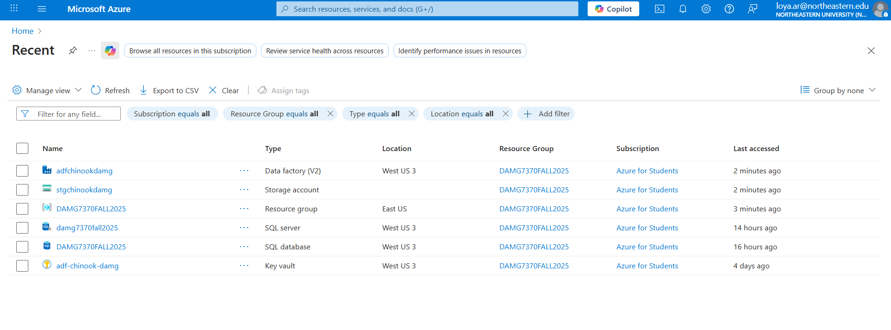
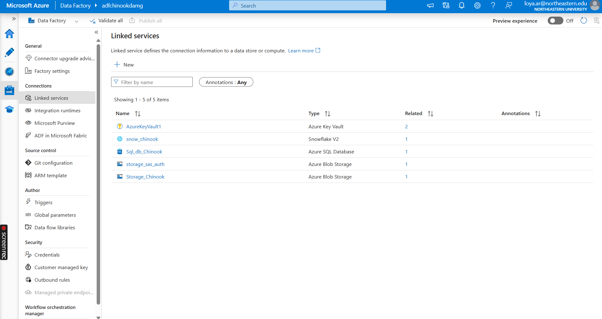
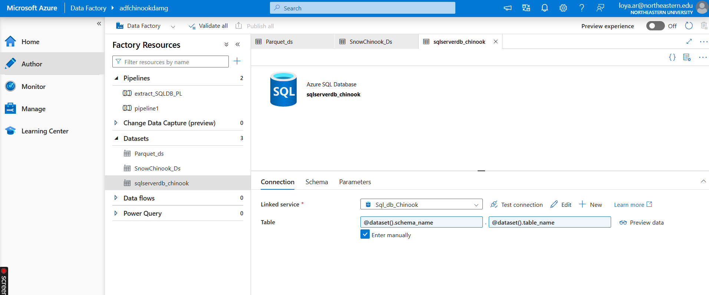
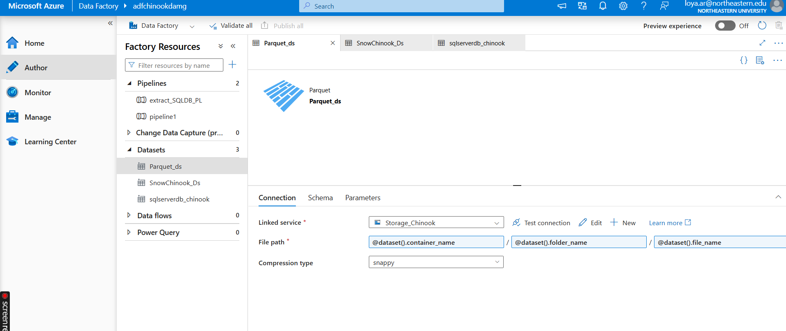
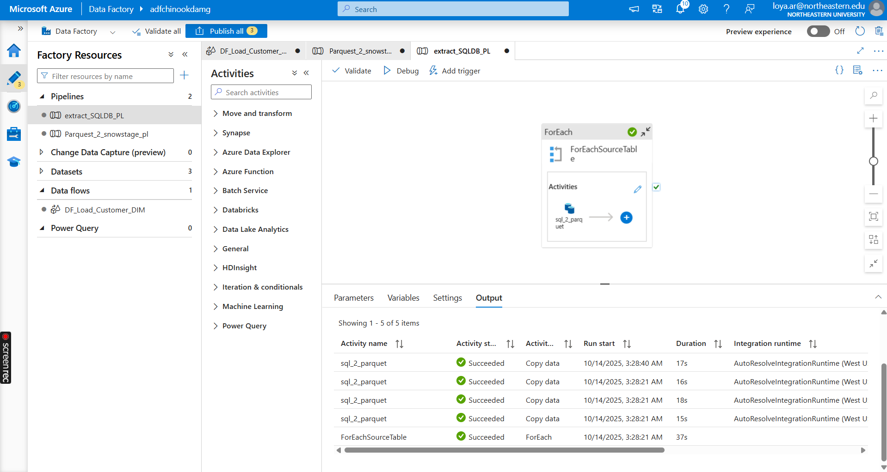
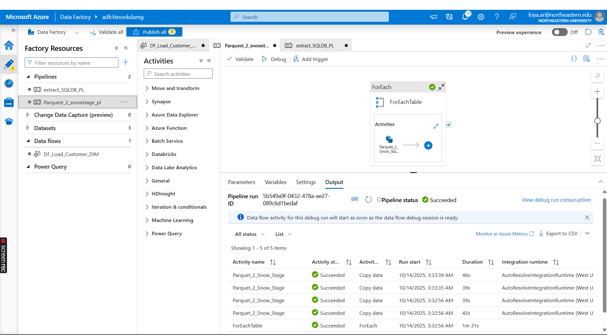
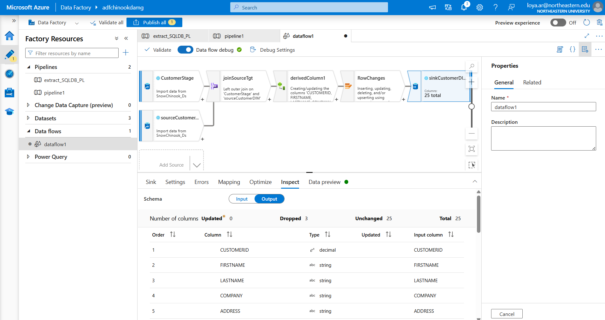
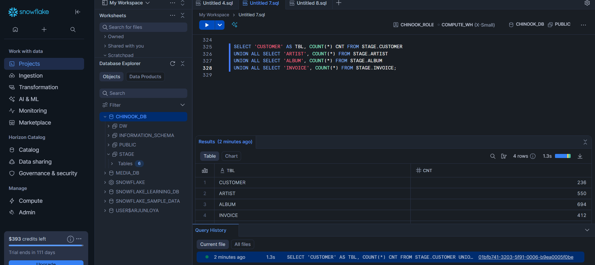
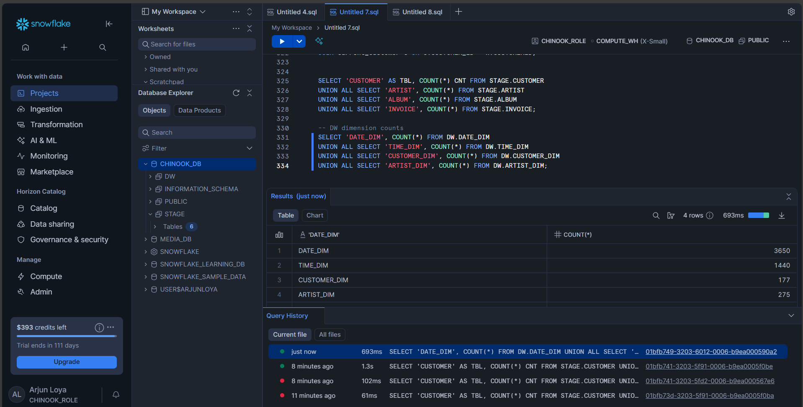
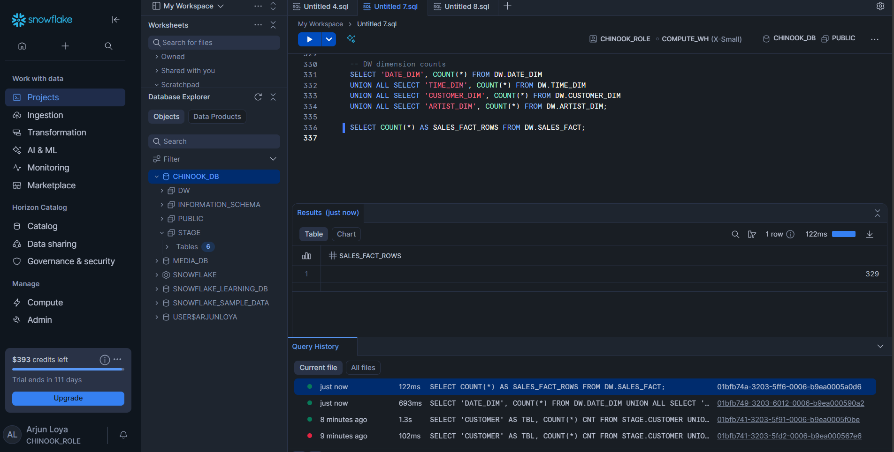

# Chinook OLTP → Snowflake Data Warehouse

An end-to-end ELT pipeline that moves the **Chinook** music-store database from **Azure SQL** into a **Snowflake** star schema, orchestrated with **Azure Data Factory (ADF)**.

```
Azure SQL DB ──(ADF Copy)──► Azure Blob (Parquet) ──(ADF Copy)──► Snowflake STAGE ──(SQL / Data Flow)──► Snowflake DW
   Chinook                     snappy-compressed                   raw landing tables                 dims + SALES_FACT
```

## Contents

- [Tech stack](#tech-stack)
- [Repository layout](#repository-layout)
- [Data model](#data-model)
- [Prerequisites](#prerequisites)
- [Run order](#run-order)
- [ADF pipelines and data flow](#adf-pipelines-and-data-flow)
- [Validation](#validation)
- [Screenshots](#screenshots)

## Tech stack

| Layer | Service |
|---|---|
| Source | Azure SQL Database (Chinook) |
| Orchestration | Azure Data Factory (pipelines + mapping data flow) |
| Lake / staging | Azure Blob Storage (Parquet, snappy) |
| Secrets | Azure Key Vault |
| Warehouse | Snowflake (`CHINOOK_DB`, warehouse `COMPUTE_WH`) |

## Repository layout

```
.
├── README.md
├── sql/
│   ├── 01_create_stage_schema.sql   # STAGE landing tables (optional if ADF creates them)
│   ├── 02_create_dw_schema.sql      # DW dimensions, fact table and key sequences
│   ├── 03_load_date_dim.sql         # DATE_DIM, 2000-01-01 .. 2030-12-31
│   ├── 04_load_time_dim.sql         # TIME_DIM, one row per minute
│   ├── 05_merge_artist_dim.sql      # STAGE.ARTIST   -> DW.ARTIST_DIM   (MERGE)
│   ├── 06_merge_customer_dim.sql    # STAGE.CUSTOMER -> DW.CUSTOMER_DIM (MERGE, SQL alternative to the data flow)
│   ├── 07_load_sales_fact.sql       # STAGE.INVOICE  -> DW.SALES_FACT   (MERGE)
│   └── 08_validation_counts.sql     # Row-count and duplicate checks
└── docs/
    ├── chinook-oltp-to-snowflake.pdf  # Workshop write-up
    └── images/                        # Screenshots used below
```

## Data model

**STAGE** (raw copies of the source): `CUSTOMER`, `ARTIST`, `ALBUM`, `INVOICE`

**DW** (star schema):

| Table | Grain | Key | Loaded by |
|---|---|---|---|
| `DATE_DIM` | one row per day | `DATE_KEY` (YYYYMMDD) | `03_load_date_dim.sql` |
| `TIME_DIM` | one row per minute | `TIME_KEY` (HHMM) | `04_load_time_dim.sql` |
| `ARTIST_DIM` | one row per artist | `ARTIST_KEY` (sequence) | `05_merge_artist_dim.sql` |
| `CUSTOMER_DIM` | one row per customer | `CUSTOMER_KEY` (sequence) | `06_merge_customer_dim.sql` **or** `DF_Load_Customer_DIM` |
| `SALES_FACT` | one row per invoice | `SALES_KEY` (sequence) | `07_load_sales_fact.sql` |

`SALES_FACT` references `CUSTOMER_DIM` through `CUSTOMER_KEY` and `DATE_DIM` through `DATE_DIM_KEY`.

## Prerequisites

- A running Snowflake warehouse (`COMPUTE_WH` or your own) and a database named `CHINOOK_DB`
- ADF linked services for Azure SQL, Blob Storage, Key Vault and Snowflake
- The ADF managed identity has **Storage Blob Data Contributor** on the target container

## Run order

| Step | Where | What |
|---|---|---|
| 1 | Snowflake | `sql/01_create_stage_schema.sql` *(optional if the ADF copy creates the tables)* |
| 2 | Snowflake | `sql/02_create_dw_schema.sql` |
| 3 | Snowflake | `sql/03_load_date_dim.sql` |
| 4 | Snowflake | `sql/04_load_time_dim.sql` |
| 5 | ADF | Run `extract_SQLDB_PL`, then `Parquest_2_snowstage_pl`, to land data in `STAGE.*` |
| 6 | Snowflake | `sql/05_merge_artist_dim.sql` |
| 7 | Snowflake / ADF | `sql/06_merge_customer_dim.sql` **or** the ADF data flow `DF_Load_Customer_DIM`, not both |
| 8 | Snowflake | `sql/07_load_sales_fact.sql` |
| 9 | Snowflake | `sql/08_validation_counts.sql` |

Steps 3–8 are safe to re-run: the date and time loads truncate first, and the dimension and fact loads are `MERGE`s that de-duplicate their source.

> **Tip:** add a pre-copy script such as `TRUNCATE TABLE STAGE.<table>` to the Snowflake sink of `Parquest_2_snowstage_pl`. Without it, every pipeline run appends another copy of the data to `STAGE`.

## ADF pipelines and data flow

**`extract_SQLDB_PL`**: Azure SQL → Parquet in Blob
- Parameter `table_names_array = ["Customer", "Artist", "Album", "Invoice"]`
- `ForEach` over the array → Copy activity `sql_2_parquet`

**`Parquest_2_snowstage_pl`**: Parquet → Snowflake `STAGE`
- `ForEach` → Copy activity `Parquet_2_Snow_Stage`

**`DF_Load_Customer_DIM`**: `STAGE.CUSTOMER` → `DW.CUSTOMER_DIM`
- Sources: `STAGE.CUSTOMER` and the existing `DW.CUSTOMER_DIM`, joined with a left outer join
- Derived column: `CUSTOMER_HASH = sha2(256, concat(<tracked columns>))`
- Alter row + sink: upsert into `DW.CUSTOMER_DIM` on `CUSTOMER_ID`

**Datasets**: `sqlserverdb_chinook` (Azure SQL), `Parquet_ds` (Blob), `SnowChinook_Ds` (Snowflake), all parameterised by schema/table or container/folder/file.

## Validation

`sql/08_validation_counts.sql` checks:

- Row counts for each `STAGE` table
- Row counts for each `DW` dimension
- Duplicate business keys in `STAGE` and `DW` (each check should return `0`)
- `SALES_FACT` row count compared with the number of distinct invoices in `STAGE`

Expected results for the classic Chinook data set:

| Table | Rows |
|---|---|
| `DATE_DIM` | 11,323 |
| `TIME_DIM` | 1,440 |
| `CUSTOMER_DIM` | 59 |
| `ARTIST_DIM` | 275 |
| `SALES_FACT` | 412 |

> The validation screenshots below come from the original workshop run, before these scripts were tidied. They show `DATE_DIM` at 3,650 rows and `SALES_FACT` at 329 rows. The old date dimension started on 2010-01-01, so the fact load's inner join dropped every earlier invoice (83 of the 412). The screenshots also show `STAGE` holding duplicate copies from repeated pipeline runs. The current scripts fix both problems.

## Screenshots

<details>
<summary><b>Azure setup</b></summary>

**Resource group:** Data Factory, Storage account, SQL server/database, Key Vault


**ADF linked services**


**Dataset: Azure SQL source (parameterised schema/table)**


**Dataset: Parquet in Blob (parameterised container/folder/file)**


</details>

<details>
<summary><b>Pipelines and data flow</b></summary>

**`extract_SQLDB_PL`: SQL → Parquet**


**`Parquest_2_snowstage_pl`: Parquet → Snowflake STAGE**


**`DF_Load_Customer_DIM`: customer dimension upsert**


</details>

<details>
<summary><b>Validation in Snowflake</b></summary>

**STAGE counts**


**DW dimension counts**


**SALES_FACT count**


</details>

## Further reading

The full workshop write-up is in [`docs/chinook-oltp-to-snowflake.pdf`](docs/chinook-oltp-to-snowflake.pdf).
