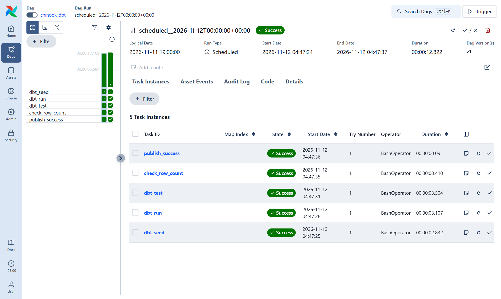
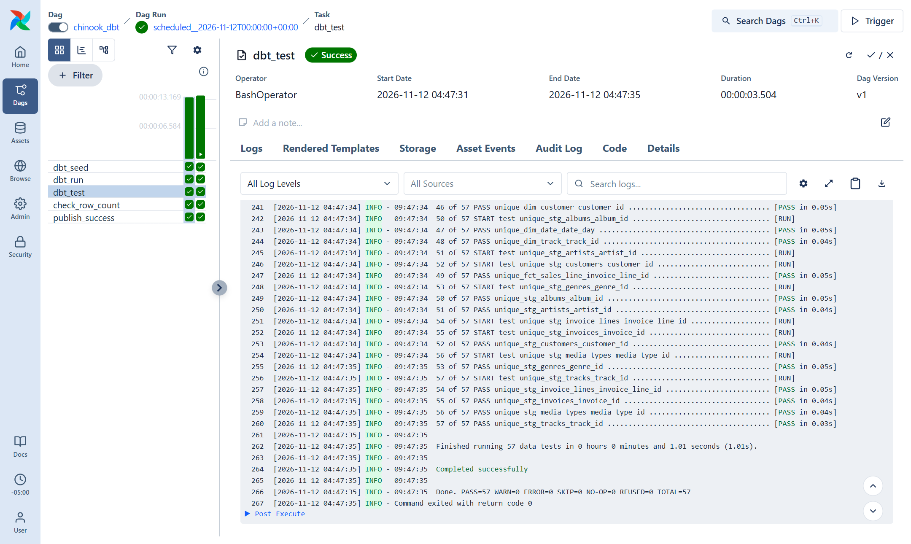
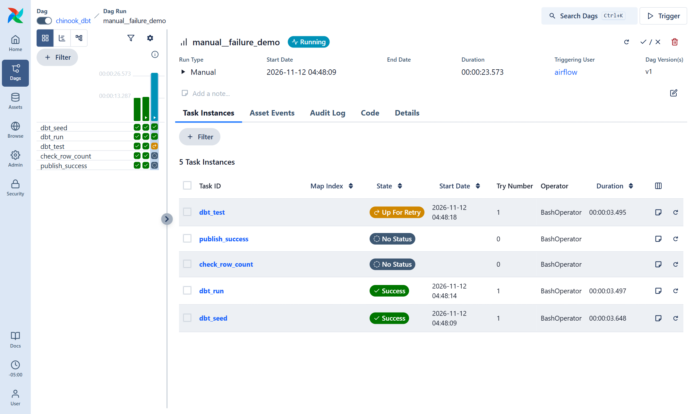
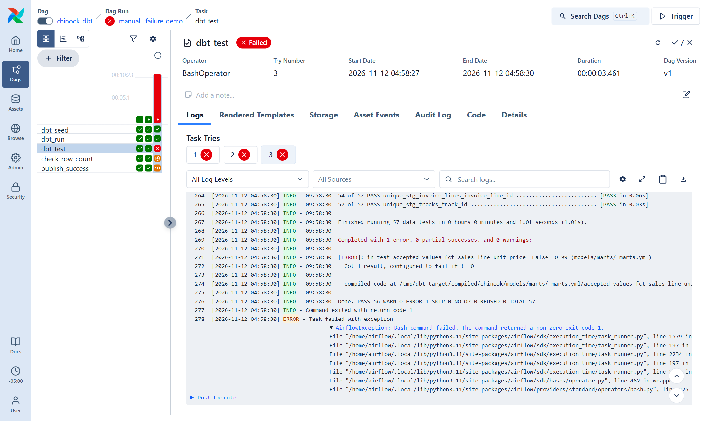
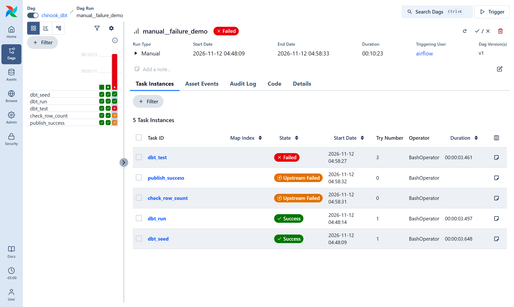

# Airflow orchestration (local)

A daily Airflow DAG that builds the [dbt project](../dbt/) on DuckDB. It runs on a
laptop in Docker. It is a local project, not a production deployment.

```
dbt_seed ──► dbt_run ──► dbt_test ──► check_row_count ──► publish_success
 8 seeds     12 models    57 tests     fact rows = seed    success message
```

## What the DAG does

[`dags/chinook_dbt_dag.py`](dags/chinook_dbt_dag.py), DAG id `chinook_dbt`:

| Setting | Value |
|---|---|
| Schedule | `@daily`, `catchup=False`, `start_date` 2026-11-01, one run at a time (DuckDB has one writer) |
| Tasks | Five `BashOperator`s in a straight line; the three dbt tasks run `dbt seed`, `dbt run` and `dbt test` with `--profiles-dir .` |
| Retries | `retries=2`, `retry_delay=5 minutes` on every task |
| Quality gate | Every task uses the default `all_success` trigger rule. If `dbt_test` fails, `check_row_count` and `publish_success` never start; Airflow marks them `upstream_failed`. |
| Row-count check | [`dags/checks/row_count.py`](dags/checks/row_count.py) fails unless `marts.fct_sales_line` has exactly one row per row of the `raw_invoice_line` seed (2,240). |
| Failure alert | `on_failure_callback` runs once a task has failed its last retry. It appends one JSON line (DAG, task, run id, run date, try number, error, log URL) to `alerts/dbt_failures.log`. If `ALERT_WEBHOOK_URL` is set, it also posts the message to that Slack or Discord webhook. None is set here. |

dbt is installed in its own virtualenv inside the image (`/opt/dbt-venv`), with the
same pinned versions as [`dbt/requirements.txt`](../dbt/requirements.txt), so its
dependencies cannot clash with Airflow's.

## Run it

Needs Docker Desktop (free for personal use) with about 4 GB of memory for Docker.

```bash
cd airflow
docker compose up -d --build
```

Open http://localhost:8080 and sign in with `airflow` / `airflow`, a login for this
local setup only. Then unpause `chinook_dbt`, or trigger it from the command line:

```bash
docker compose exec airflow-scheduler airflow dags unpause chinook_dbt
docker compose exec airflow-scheduler airflow dags trigger chinook_dbt
```

Stop it with `docker compose down` (add `-v` to delete the Airflow metadata database).

[`docker-compose.yaml`](docker-compose.yaml) is the official Airflow 3.3.2 quick-start
file, cut down for one machine: LocalExecutor with Postgres, and no Redis, Celery
workers or Flower. The repo's `dbt/` folder is mounted into the containers, so the
DAG builds the same `chinook.duckdb` file as a local `dbt build`.

## Proof it works

### A green run

The scheduled daily run for 2026-11-12: all five tasks succeeded on the first try, in 13 seconds.



`dbt_test` log from that run: `PASS=57 WARN=0 ERROR=0`.



### A deliberate failure

To check the retries, the quality gate and the alert, I broke one test on purpose: the
`accepted_values` test on `fct_sales_line.unit_price` was changed from `[0.99, 1.99]`
to `[0.99]`. Then I triggered the run `manual__failure_demo` and reverted the change afterwards.

1. `dbt_seed` and `dbt_run` succeeded. `dbt_test` failed: `PASS=56 ERROR=1`, because the
   1.99 price is no longer an accepted value. Airflow marked it **Up For Retry**, and the
   downstream tasks waited.

   

2. Airflow retried twice, 5 minutes apart (attempts at 09:48:20, 09:53:24 and 09:58:29 UTC).
   All three attempts failed on the same test.

   

3. After the third attempt, `dbt_test` was marked **Failed** and so was the run.
   `check_row_count` and `publish_success` never ran: both are **Upstream Failed**.

   

4. `on_failure_callback` fired once, after the last retry, and wrote this line to
   `alerts/dbt_failures.log`:

   ```json
   {
     "alerted_at": "2026-11-12T09:58:30+00:00",
     "dag_id": "chinook_dbt",
     "task_id": "dbt_test",
     "run_id": "manual__failure_demo",
     "run_date": "2026-11-12T09:48:09.673198+00:00",
     "try_number": 3,
     "error": "Bash command failed. The command returned a non-zero exit code 1.",
     "log_url": "http://localhost:8080/dags/chinook_dbt/runs/manual__failure_demo/tasks/dbt_test?try_number=3"
   }
   ```

After the revert, the run `manual__after_revert` was green again.

## DAG check in CI

[`tests/test_chinook_dbt_dag.py`](tests/test_chinook_dbt_dag.py) loads the DAG folder
with Airflow's `DagBag` and checks:

- no import errors, and `chinook_dbt` is the only DAG
- the task order is exactly `dbt_seed → dbt_run → dbt_test → check_row_count → publish_success`
- every downstream task uses `all_success` (the quality gate)
- `@daily`, `catchup=False`, 2 retries 5 minutes apart and a failure callback on every task
- each dbt task passes `--profiles-dir .`

The [`Airflow DAG check`](../.github/workflows/airflow-dag.yml) workflow runs these tests
on every push and pull request that touches `airflow/`. It installs Airflow 3.3.2 with
the official constraints file. It does not run dbt; the
[`dbt build`](../.github/workflows/dbt.yml) workflow does that.

Run the tests locally inside the image:

```bash
docker run --rm -v "$PWD:/work" -w /work -e AIRFLOW__CORE__LOAD_EXAMPLES=false \
  --entrypoint bash chinook-airflow:3.3.2 \
  -c "pip install -q pytest && airflow db migrate >/dev/null && python -m pytest -v tests"
```

## Deliberately not included

- **No cloud deployment.** No managed Airflow (MWAA, Cloud Composer or Astronomer) and no Kubernetes. It runs on one machine in Docker.
- **No production hardening.** The login, JWT secret and Postgres password are fixed local-development values, there is no secrets manager, and there is no monitoring beyond the alert log.
- **No real alert channel.** Failures go to a log file. The webhook hook is there but unused.
- **No backfills.** `catchup=False`. The sample data does not change day to day, so each run rebuilds the same tables.
